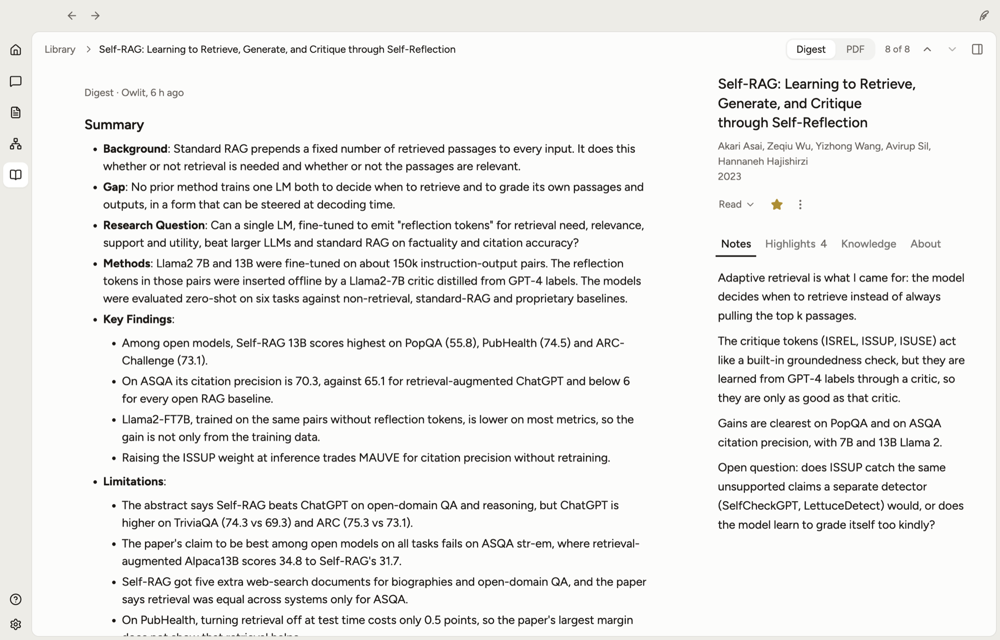
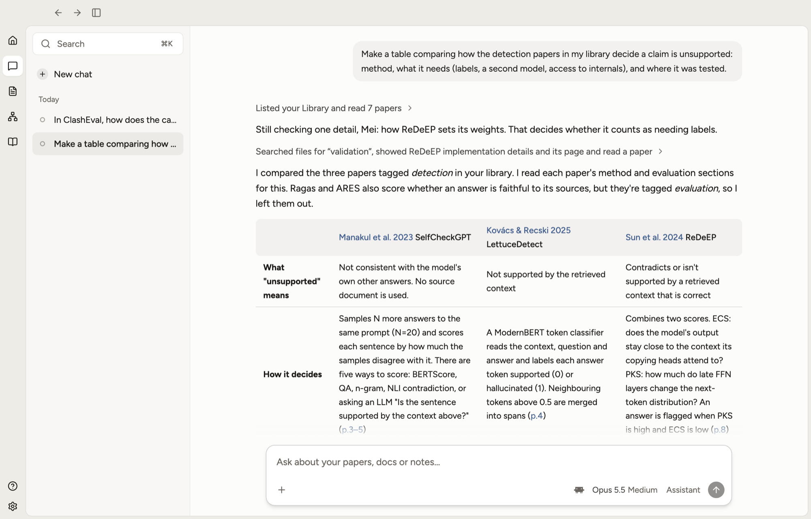

<p align="center">
  <picture>
    <source media="(prefers-color-scheme: dark)" srcset=".github/readme/lockup-dark.svg">
    
  </picture>
</p>

<h3 align="center">Read, write and think through papers with Owlit.</h3>

<p align="center">
  A research workspace for macOS where you and an assistant develop ideas together,<br>
  from first reading to written argument. Everything is files in a folder you own.
</p>

<p align="center">
  <a href="https://github.com/hsiachi/owlit/releases/latest">Download for Mac</a> ·
  <a href="#install">Install</a> ·
  <a href="#your-data">Your data</a> ·
  <a href="CONTRIBUTING.md">Contributing</a>
</p>



> [!NOTE]
> owlit is early. It runs on Macs with Apple silicon, it's used by a few people, and things will change.
> If something breaks, Help › Copy Diagnostics and [open an issue](https://github.com/hsiachi/owlit/issues).

## What it is

owlit is the app; **Owlit** is the assistant inside it. Owlit works through an agent you may already have:
Claude Code, Codex or Gemini CLI, or owlit's own engine.

- **Library**: collect papers (import from Zotero, a BibTeX file or a folder of PDFs, or search). Owlit
  writes a digest of each one; your highlights and notes sit beside it.
- **Chat**: ask about your papers, docs and notes, or hand work off. Answers cite the page they came from.
- **Docs**: write in Markdown. Ask Owlit about a passage, or let it suggest an edit you can see and undo.
- **Collections**: give Owlit a question and it gathers papers on it, with what each one says and how far
  it read, in a list or a table you can sort, group and correct. Papers stay out of your Library until you
  use them.
- **Home**: where you land, with what you were in the middle of.



## How Owlit works with you

- **Owlit understands your work, and you can correct that understanding.** It keeps a running account of
  what you're trying to figure out, what you believe so far and what you read, built from your work, never
  something you maintain. It's text you can read, and correcting it is just writing.
- **Owlit takes initiative, and everything it does can be undone.** Instead of asking permission, it does
  the thing, so you see exactly what it means, and you undo it in one step.
- **You stay aware of what Owlit does.** Each change shows where it happened, signed, with what was there
  before one step away. You can leave for a month and read from the work what moved.
- **Owlit leaves room for your thinking.** There is always a place where only your words live, and your
  views and Owlit's are never blurred. It offers material for thinking before conclusions.

## Install

1. [Download the latest dmg](https://github.com/hsiachi/owlit/releases/latest), open it and drag Owlit
   into Applications.
2. The first time, macOS says it can't check Owlit (it isn't notarised by Apple yet). Open System Settings ›
   Privacy & Security, scroll down, click **Open Anyway** and confirm. Each new version asks once more.
3. Owlit works through Claude Code or Codex. If one is on your Mac, Owlit offers to set it up for itself
   (about 300 MB; no Node or npm needed). Not signed in? Run `claude` (or `codex`) in Terminal once.
   You can also use Gemini CLI, or owlit's own engine with a ChatGPT sign-in or an API key.
4. On first launch, pick a folder for your workspace, or explore the example workspace first.

After an update, macOS may ask once for your password so Owlit can read its saved keys: choose
**Always Allow**. owlit doesn't check for updates yet; watch this repo's releases to hear about new ones.

## Your data

- **A folder is the workspace.** Docs are Markdown files, papers are in `library/`, collections and chats
  sit beside them in `.owlit/`. Back it up, sync it or put it in git like any folder. Exporting is
  copying it.
- **Other programs are welcome.** Edit your docs in any editor; owlit follows changes on disk and never
  overwrites them. Opening a file in owlit changes nothing.
- **What leaves your Mac:**
  - What you ask, and the files Owlit reads to answer, go to the agent you chose and from there to its
    provider (Anthropic for Claude Code, OpenAI for Codex, and so on), under your own account.
  - Paper lookups go to public catalogues (OpenAlex, Crossref, Semantic Scholar, arXiv, Unpaywall) and to
    publishers when you fetch a PDF.
  - PDFs are uploaded only if you turn on MinerU cloud parsing in Settings.
  - Sharing a doc by link sends the share server only what readers see: the doc, and the digests of the
    papers it cites (and your notes, if you allow it). PDFs never go there, and the key that changes a
    link stays on your Mac. Nothing is shared until you press Share. The dmg on the releases page uses a
    share server the maintainer runs on Cloudflare; a build from source has no share server unless you
    [run your own](apps/share-worker/README.md).

## Use owlit's tools from another agent

owlit gives its agents tools for your library, docs and chats (an MCP server). Other agents can use them too,
while owlit has the workspace open. Install the `owlit` command (Owlit › Install Command Line Tool…), then,
for Claude Code:

```bash
claude mcp add owlit -- owlit mcp --workspace ~/Research
```

`--workspace` is the folder open in owlit. The same command works in a terminal: `owlit --help` lists
what it can do (search the library, add a paper, read a digest, import).

## Contributing

owlit is a pnpm workspace (React, Vite, Electron, plain Node). To run it from source:

```bash
pnpm install
pnpm dev
```

[CONTRIBUTING.md](CONTRIBUTING.md) has the layout, the commands and how releases are made. The share
server's own notes are in [apps/share-worker](apps/share-worker/README.md).

## License

[AGPL-3.0-or-later](LICENSE). You may use, change and share owlit; if you share a changed version, or run
one as a service for others (such as the share server), you share its source under the same license.

The name "owlit" and the feather logo aren't covered by the license: please give a fork its own name.
